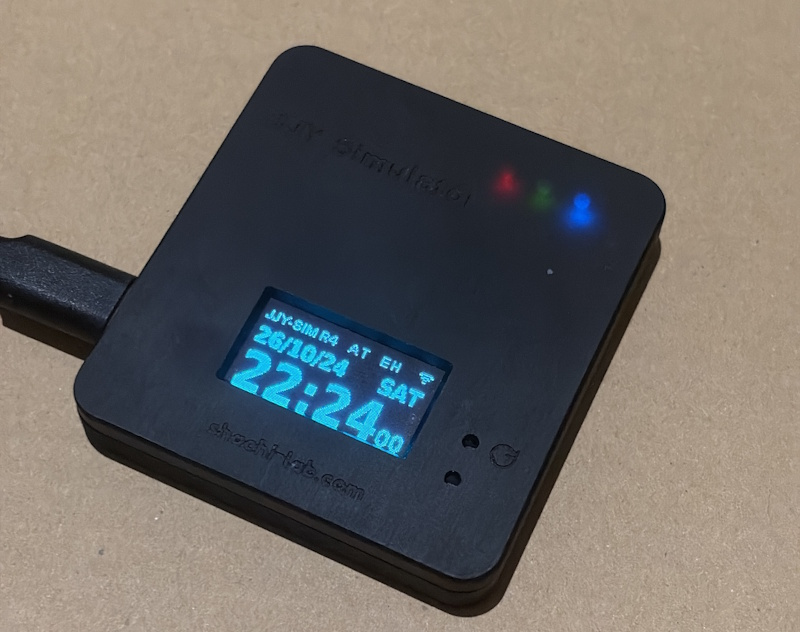
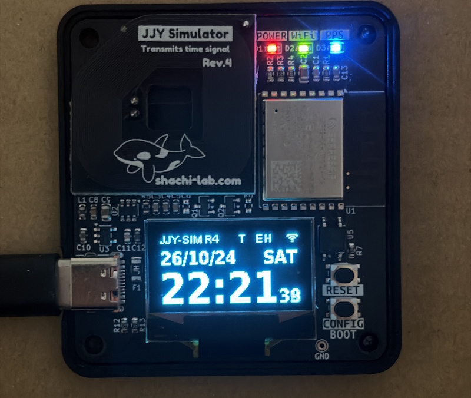
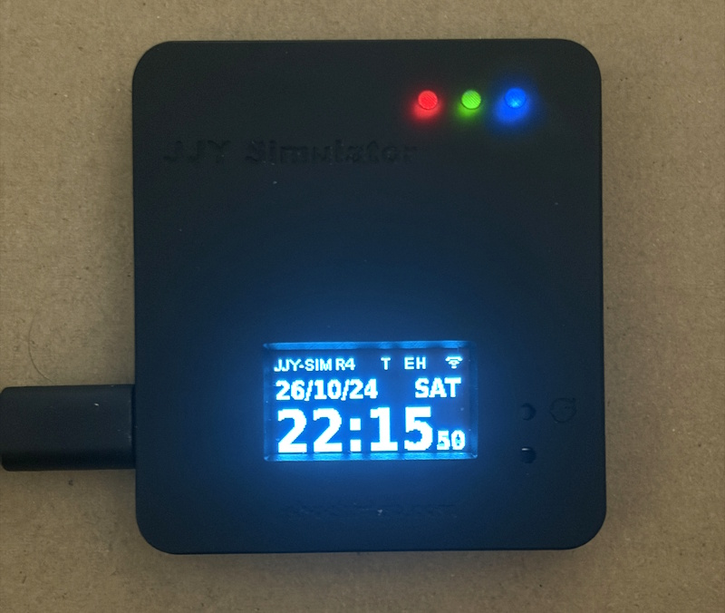

# 📡 JJY-SIM R4 (with R3 design references)

Build your own JJY time-signal simulator with an ESP32-C3 or ESP8684!  
This compact simulator reproduces the 40 kHz / 60 kHz JJY radio time signal using PWM output,  
based on accurate time obtained from NTP.  
R2, R3 and R4 share an ESP-IDF firmware codebase.  

**R4 is the latest model. The older R3 design files are retained for reference.**

The firmware version is **1.2.0**.

👉 [README 日本語版はこちら](README_ja.md)

---

## R4 / R3 / R2 layout

| Item | R4 (latest model) | R3 (older model, for reference) | R2 (older model) |
|---|---|---|---|
| Exterior | Antenna inside the case | Antenna outside the case | Similar to R3 |
| MCU | ESP32-C3 | ESP8684 (ESP32-C2) | ESP32-C3 |
| Resonance selection | Automatic switching via GPIO3 | On-board switch | Solder jumpers |
| Firmware | Shared source, esp32c3 build | Shared source, esp32c2 build | Shared source, esp32c3 build |
| Hardware design files | Included (r4 / r4.1, r4_ant)| Included for reference (r3)| Not included |

R3 and R4 use PCB antennas. R4 stacks a main PCB and three antenna PCBs inside the case. R3 integrates the main circuitry and antenna on one PCB, with the antenna extending outside the case.

R2 has an exterior similar to R3, but uses an ESP32-C3 and solder jumpers for resonance selection. It can use the C3 build of the shared firmware. R2 hardware design files are not included in this repository.

The shared R2/R3/R4 firmware sources are in `firmware/idf/jjy-sim`.
R4 is identified by the eFuse field `USER_DATA_JJYSIM_HW_GENERATION` set to `4`. An unconfigured ESP32-C3 runs as R2. A self-built R4 requires this identification field to be programmed. eFuse writes are irreversible; verify the board and `main/esp_efuse_custom_table.csv` before programming.

See the [USB flashing instructions (Japanese)](firmware/idf/jjy-sim/README.md).

Board designs are in `hardware/KiCad/r3`, `r4`, `r4.1` and `r4_ant`, with shared libraries in `hardware/KiCad/lib`. Each board has its own `PLOT` directory. Case models are in `hardware/case_3d/r3` and `r4`.

`hardware/KiCad/r4.1` contains an alternative component layout for the R4 PCB. The order of the L/C/R components in the resonant circuit has also been changed to accommodate the new layout.

## 🪛 Features

* Generates **JJY 40 kHz / 60 kHz** signals from time obtained via **NTP**
* Equipped with a **PCB antenna** (inside the case on R4)
* Shows the time and operating status on an **OLED display**
* Configures Wi-Fi and operating settings through a **web browser**
* Supports **Hourly Mode, Night Mode and a screen saver**
* Distributes time to devices on the LAN as an **NTP server**
* Supports firmware updates over Wi-Fi via **OTA updates**

*R4 exterior*  

<a href="./images/jjy-sim-r4.jpg">
</a><br/>

*For reference: the older R3 model below*  

<a href="./images/jjy-sim-r3.jpg">
</a><br/>

---

## 🛠 Build and Flash (ESP-IDF / CLI)

Use **ESP-IDF v5.5.4** and run these commands from `firmware/idf/jjy-sim`. Arduino builds are not supported.

R3 (ESP8684 / ESP32-C2):

```bash
idf.py -B build-c2 -D IDF_TARGET=esp32c2 -D SDKCONFIG=sdkconfig.c2 build
idf.py -B build-c2 -D IDF_TARGET=esp32c2 -D SDKCONFIG=sdkconfig.c2 -p COMx flash monitor
```

R4 (ESP32-C3):

```bash
idf.py -B build -D IDF_TARGET=esp32c3 -D SDKCONFIG=sdkconfig.c3 build
idf.py -B build -D IDF_TARGET=esp32c3 -D SDKCONFIG=sdkconfig.c3 -p COMx flash monitor
```

Replace `COMx` with your serial port. `partitions.csv` defines the OTA partition layout. Migration from the old layout requires USB flashing including the partition table, not just the application image.

### Program the R4 identification eFuse

The ESP32-C3 on a self-built R4 needs the identification value `4`. **Do not run this procedure on R3. eFuse programming is irreversible.**

In an ESP-IDF environment, change to `firmware/idf/jjy-sim` and replace `COMx` with the port of the target R4. These commands use a USB connection.

First, check the current value:

```powershell
espefuse --chip esp32c3 -p COMx --before usb_reset --extend-efuse-table main/esp_efuse_custom_table.csv summary
```

Confirm that `USER_DATA_JJYSIM_HW_GENERATION` is `0` (unprogrammed) before writing `4` with the command below. If it is already `4`, no write is needed. For any other value, do not attempt to overwrite it using this procedure.

```powershell
espefuse --chip esp32c3 -p COMx --before usb_reset --extend-efuse-table main/esp_efuse_custom_table.csv burn_efuse USER_DATA_JJYSIM_HW_GENERATION 4
```

Review the target and changes shown by the tool, then follow its confirmation prompt. After programming, run the `summary` command again and confirm that the value is `4`. Restart the board so that the firmware identifies it as R4.

---
## 🛠 Build and Flash (VSCode / GUI)

You can also develop this project using **VSCode + the ESP-IDF Extension**.

### ■ Recommended Extension

* ESP-IDF Extension (Espressif)

By installing the extension in VSCode, you can perform the following from the GUI:

* Build
* Flash
* Serial monitor

### ■ Setup

Set up your environment according to the ESP-IDF Extension instructions.

Once the extension is installed, you can run actions such as:

* `Build`
* `Flash`
* `Monitor`

with a single click.

### ■ Workspace

When opening the project in VSCode,
open **`JJY-SIM.code-workspace`** in the source-code folder
then select your local ESP-IDF 5.5.4 installation and either `C3 (R2 / R4)` or `C2 (R3)` configuration.

---

## ⚙️ Usage

Refer to the model-specific manuals on the [JJY-SIM support page](https://blog.shachi-lab.com/support/) for settings, screens and controls.
R4 switches its resonance circuit automatically with the BAND setting. On R3, also set the on-board switch to match the selected BAND.

---
## 🔌 Pin Assignment (Main Signals)

| Function       | GPIO | Notes                                                        |
| -------------- | ---- | ------------------------------------------------------------ |
| JJY PWM output | 10,4 | Modulated output signals, inverted A/B pair for the H-bridge |
| R4 BAND selection | 3 | R4 only; resonance circuit switching |
| CONFIG switch  | 9    | Used for Wi-Fi setup (**shared with BOOT pin**)              |
| ACT LED        | 5    | Activity LED                                                 |
| IND LED        | 0    | Status indicator LED (can be shared)                         |
| OLED Reset     | 2    | OLED module reset                                            |
| OLED SDA       | 7    | OLED I2C data                                                |
| OLED SCL       | 6    | OLED I2C clock                                               |

---

## 🧾 File Structure

### 💻 Firmware

* The firmware source code is located in the **`firmware/idf`** folder.
* This firmware uses a rebuilt library, ported as an IDF component, based on the Arduino OLED driver library used in R2.  
This component is publicly available on GitHub.  
👉 [SSD1306 OLED display driver](https://github.com/Shachi-lab/oled_display)
* `storage_key.h` contains placeholder values and can be used as-is.  
  For better security, you may want to replace them with your own values before building.

### 🧰 Hardware

* The hardware design files are located in the **`hardware`** folder.
* The schematic and PCB design data are in **`hardware/KiCad`**.

  * Saved with **KiCad 10** (R4 design files require KiCad 10 or later)
  * **Gerber data** is included in **`hardware/KiCad/<revision>/PLOT`**, so the board can be fabricated as-is
* The 3D case data is in **`hardware/case_3d`**.

---

## 🔧 DIY Assembly

### R4 antenna

Building an R4 requires **stacking three antenna PCBs**. The antenna stack and main PCB fit inside the case.

PCB thickness: **1.6 mm for the main PCB and 0.8 mm for each antenna PCB**.

### OLED supports (R3 / R4)

Both R3 and R4 PCBs include tab-shaped sections for the OLED supports. **Break these sections off during assembly and use them as supports for the OLED.**

### Case screws

Use **hex M2 × 5 mm self-tapping screws** to fasten the case.

---

## 📸 Appearance / Assembly Examples

The photos below show the R4 board and case.  
The design uses a black PCB and a black case so that only the display appears to float visually.

<a href="./images/jjy-sim-r4_pcb.jpg">
</a>
<a href="./images/jjy-sim-r4_case.jpg">
</a><br/>

### R3 (for reference)

The photos below show the R3 board and case.  

<a href="./images/jjy-sim-r3_pcb.jpg">
</a>
<a href="./images/jjy-sim-r3_case.jpg">
</a><br/>

---

## ⚠️ Caution

The R4 antenna section becomes slightly warm during operation.

This device may radiate farther than expected.  
Please make sure to comply with applicable radio regulations when experimenting with it.

---

## 🔗 Support / Documentation  

For the latest information, setup guide, and detailed usage notes, please see the support page.  
👉 [JJY-SIM Support Page](https://blog.shachi-lab.com/support/)  
>Note: The support page is currently available in Japanese only.

---
## 📝 Attribution

JJY-SIM is released under the MIT License.  
You are free to use, modify, and build upon this project.  

When selling, distributing, or publicly releasing something based on JJY-SIM, please include attribution to **Shachi-lab / JJY-SIM** somewhere visible, such as the product page, documentation, README, package, or other accompanying materials.

Example:

* Designed by Shachi-lab
* Based on JJY-SIM by Shachi-lab
* Inspired by JJY-SIM by Shachi-lab
